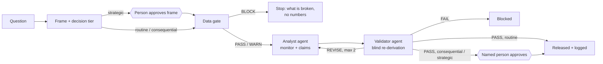

# Games Portfolio Agent

An autonomous Claude Code agent that tells a game publisher which titles in its catalog moved this month,
by how many dollars, and what to check first. It checks the data before analysing it, ranks the
exceptions, has an independent validator re-derive every number, and stops for a named person's approval
before anything consequential goes out.

> **Course project.** Built as the final project for **Carnegie Mellon University, School of Computer
> Science, Executive Education: Agentic AI Program: Building Autonomous Systems for Real-World
> Applications.**
>
> **The data is fake.** Every number in this repository comes from **Halcyon**, a fictional publisher.
> The dataset is AI-generated and exists only to develop and evaluate this agent. No real company, game,
> storefront account or sale is described. See [The data](#the-data).

## The problem

A publisher's back catalog is hundreds of store listings (one title on one storefront). Every month a
commercial analyst works out by hand which ones need attention, and it goes wrong in predictable ways:

- a store listing breaks on one storefront and the loss runs for weeks before anyone notices;
- a data load duplicates a row, or drops one, and a fake spike or drop reaches the leadership update;
- a store-wide sale makes every listing look like it jumped;
- the write-up says a patch *caused* a drop when the data only shows *where* revenue moved.

**Users:** the commercial or portfolio analyst at a premium (PC and console) publisher, and the commercial
lead who acts on the monthly report.

## What the system does



One command runs the whole loop: `/games-portfolio <question>`. The orchestrator frames the question,
delegates to two subagents, acts on the verdict and asks a person only where the rules require it.

| Component | File | Job |
|---|---|---|
| Orchestrator | `.claude/skills/games-portfolio/` | Frames the question, sets the tier, delegates, loops on REVISE, stops for approval |
| Analyst agent | `.claude/agents/games-portfolio-performance.md` + `games-portfolio-monitor` skill | Runs the gate and monitor, writes checkable claims with hypotheses |
| Validator agent | `.claude/agents/games-portfolio-validator.md` + `games-portfolio-validation` skill | Re-derives every claim blind; no edit tools |
| Data gate | `portfolio_agent/portfolio.py::data_gate` | Blocks broken inputs; removes and discloses duplicates; excludes listings with a missing row; flags negative net |
| Monitor | `portfolio_agent/portfolio.py::monthly_exceptions` | Each listing against its expected month; ranked by dollars; title-wide moves grouped |
| Validator code | `portfolio_agent/validation.py` | Standard-library re-implementation; 8 checks graded blocking / major / minor |
| Oversight | `portfolio_agent/oversight.py` | Tiers, release rules, named approval, `trace.jsonl` per run |
| Run steps | `portfolio_agent/run.py` | `frame`, `analyze`, `validate`, `all` (CLI) |

### How "expected" is defined

For listing *l* in month *m*:

- **base** = median of the listing's 6 previous months (all 6 must exist)
- **change** = ln((net + 1) / (base + 1))
- **storefront factor** = median change of every listing on the same storefront that month (at least 10)
- **expected** = (base + 1) x exp(storefront factor) - 1

Seasonality and store-wide sales move the peers too, so they cancel. A listing is flagged when its change
minus the storefront factor is at least 3.5 robust standard deviations (MAD of the same residual over its
last 24 months) **and** the gap is at least $1,000. Listings under 12 months old are listed, not scored.

### Design decisions

- **A skill proposes; code verifies.** Every number comes from a tested Python function. The agents
  decide what to run and how to word it.
- **Blind, independent validation.** The validator sees only the claims and the raw file. It shares no
  code with the monitor (standard library only), so one bug can't hide in both.
- **Hypotheses, never causes.** Monthly revenue shows where money moved. Each incident names its most
  likely explanation and the check that would confirm it.
- **People decide.** Strategic questions (price, delist, sunset, invest, deal) need a person to approve
  the frame before any data is read. Anything above routine needs a named approver after validation.
- **Fail closed.** Broken data stops the run with a reason and no numbers. A FAIL can never be approved.

## The data

**Halcyon is a fictional premium game publisher. The data is AI-generated and fake, built only for
evaluating this agent.** Titles, storefront revenue and dates are invented. The files are committed as
delivered in [`data/halcyon/`](data/halcyon/):

| File | Rows | Columns | What it is |
|---|---|---|---|
| `halcyon_catalog.csv` | 238 | `listing_id, title, platform, release_month` | One row per store listing: 165 titles on steam (149), playstation (54) and nintendo (35). 49 listings have no release month. |
| `halcyon_monthly_net.csv` | 13,425 | `listing_id, title, platform, month, net_usd` | Net revenue per listing per month, 2014-01 to 2025-12. About $1.3M a month in 2025; 13 listing-months are negative. |
| `halcyon_items_latest_year.csv` | 256 | `product_name, store_item_name, platform, item_type, net_usd` | 2025 net revenue by store item: base game (238), DLC (10), soundtrack (8). Shipped for completeness; the monitor does not use it. |

Things to know about it:
- **Months are calendar months as delivered.** The source states no timezone; outputs say so.
- **`net_usd` is used as delivered.** The source does not break out gross, tax, refunds or platform fees.
- **It is noisy on purpose.** Listings often double or halve month to month on their own promotions,
  which sets the monitor's detection limit (see [Evaluation](#evaluation)).
- **It has no answer key.** For evaluation, `portfolio_agent/data.py::plant` copies the data up to a chosen
  month and plants known problems into that month, writing the answers to `truth.json`:

| Planted | Kind | What changes |
|---|---|---|
| listing_outage | business | one listing falls to 2% of its month |
| price_error | business | one listing at 3x |
| demand_collapse | business | every established listing of one title at 0.4x |
| clawback | business | one listing's net goes negative (-0.5x its base) |
| duplicate_row | data issue | one listing-month loaded twice |
| missing_row | data issue | one listing-month dropped |

Planted problems only touch listings the monitor covers (12+ months of history, $5,000+ a month).
Runs without `--plant-seed` use the data exactly as delivered.

## Setup

Python 3.11+. Windows (PowerShell):
```powershell
git clone -b portfolio-agent https://github.com/danyfromspace/ai-analyst.git games-portfolio-agent
cd games-portfolio-agent
python -m venv .venv; .\.venv\Scripts\Activate.ps1
pip install -r requirements.txt
python -m pytest
```
macOS / Linux: the same, with `source .venv/bin/activate`.

## Usage

**With Claude Code** (the agent):
```
claude
/games-portfolio Which titles need attention this month? --as-of 2025-12
/games-portfolio Which titles need attention this month? --as-of 2025-12 --plant-seed 1
/games-portfolio Should we delist Wildspire on Steam?
```
The last one stops and asks a person to approve the frame.

**Without a model** (the same pipeline):
```powershell
python -m portfolio_agent.run all --question "Which titles need attention this month?" --as-of 2025-12
python -m portfolio_agent.oversight status  runs/<run_id>
python -m portfolio_agent.oversight approve runs/<run_id> --by "Your Name"
```
Each run folder holds `frame.json`, `gate.json`, `exceptions.json`, `claims.json`, `report_draft.md`,
`validation.json`, `status.json` and `trace.jsonl` (plus `monthly.csv` and `truth.json` for planted runs).
Two complete runs are in [`docs/sample_runs/`](docs/sample_runs/):

- **As delivered, 2025-12:** gate PASS; two exceptions (Cindervale on Nintendo +$21,146; The Wild Odyssey
  on Steam -$14,014); validator PASS; routine, so released.
- **Planted (seed 1), 2025-12:** gate WARN (duplicate removed and disclosed, missing row excluded, negative
  net flagged); the planted outage and clawback rank 1 and 2; validator PASS; $231k at stake, so it waits for
  a named approver.

## Evaluation

`python -m portfolio_agent.evals --seeds 40` (about 3 minutes). Full results:
[`docs/eval_results.md`](docs/eval_results.md).

| Criterion | Result (40 planted months, 2021-2025) |
|---|---|
| Listing outages ranked in the top 10 | **38/40** |
| Negative-net clawbacks ranked in the top 10 | **39/40** |
| Title-wide 0.4x collapses ranked in the top 10 | 22/40 |
| Single-listing 3x price errors ranked in the top 10 | 14/40 |
| Unplanted alerts | 1.85 a month |
| Data issues reported as performance without a note | **0** (naive preparation: 45) |
| Clean claim sets wrongly failed by the validator | **0/40** |
| Planted claim errors caught (8 families) | **318/318** |
| Unit tests | 68 (`python -m pytest`) |

**What this shows.** The agent reliably catches near-total losses and keeps data defects out of the
report. Its weak spot is clear: on monthly data, a 2x-3x move on one listing looks like a promotion. The
detection curve (one listing shocked, everything else as delivered) puts single-listing detection at 76%
for x0.1, 37% for x0.3, 21% for x2 and 42% for x3.

**What this doesn't show.** The planted errors and the checks were written by the same author, so 318/318
says the checks catch the families they were designed for. Model behaviour (framing, wording, routing,
stopping for approval) is covered by eight hand-run cases in
[`evals/agent_cases.yaml`](evals/agent_cases.yaml), not by CI.

## Safety, reliability and human oversight

- **Before analysis:** the data gate blocks unknown storefronts, listings missing from the catalog and
  months with no data, and returns the reason with no numbers. Duplicates are removed and disclosed,
  missing rows exclude the listing, and negative net is flagged.
- **During analysis:** young listings and listings with gaps are listed as not monitored, never scored.
  Every movement is a hypothesis with a check.
- **After analysis:** the validator can't edit, and a FAIL can't be approved. REVISE loops at most twice
  before a person decides. PASS releases routine runs; consequential (over $50k at stake, or a decision)
  and strategic runs need a named approver.
- **Monitoring:** every step is written to a timestamped `trace.jsonl`, with a hash tying the approval to
  the exact claims that were reviewed.

## Limitations and next steps

- **Detection limit on monthly data.** Add weekly data and a promotion calendar so a price error can be
  told apart from a sale.
- **Blind held-out errors.** Have someone else write planted errors the checks have never seen.
- **Agent cases in CI.** Run `evals/agent_cases.yaml` headlessly and track cost per run.
- **Hypotheses are rules.** Connect the sources the agent names as checks (store status, price history,
  promotion calendar, refund reasons).
- **Real statements.** Currency, bundles, restatements and fees are not in Halcyon.

## Repository layout

```
README.md                       this file
CLAUDE.md                       house rules for Claude Code in this repo
.claude/agents/                 games-portfolio-performance, games-portfolio-validator
.claude/skills/                 games-portfolio (orchestrator), games-portfolio-monitor, games-portfolio-validation
portfolio_agent/                data, portfolio (gate + monitor + claims), validation, oversight, run, evals
data/halcyon/                   the three Halcyon CSVs (fake, AI-generated)
tests/                          68 tests
evals/agent_cases.yaml          hand-run agent cases
docs/eval_results.md            evaluation results (and .json)
docs/sample_runs/               one as-delivered run, one planted run
```

This agent is one piece of a larger Games AI Analyst project. This branch contains only this agent and
what it needs to run.
